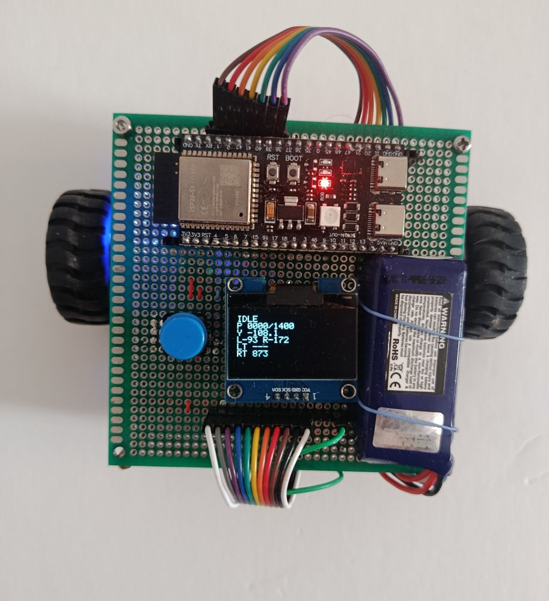
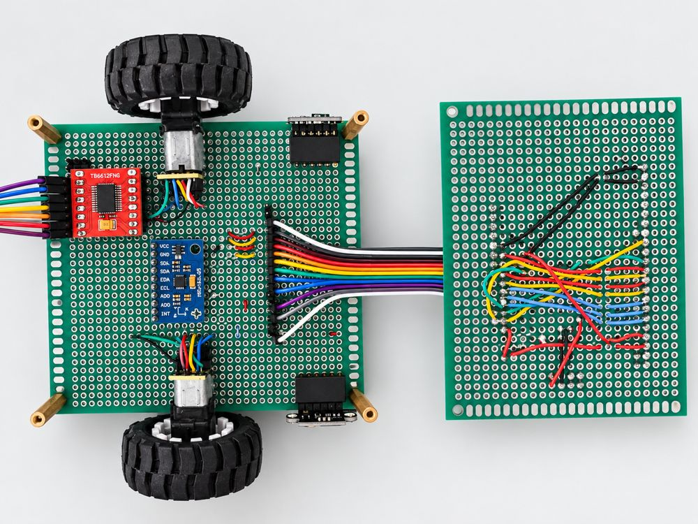
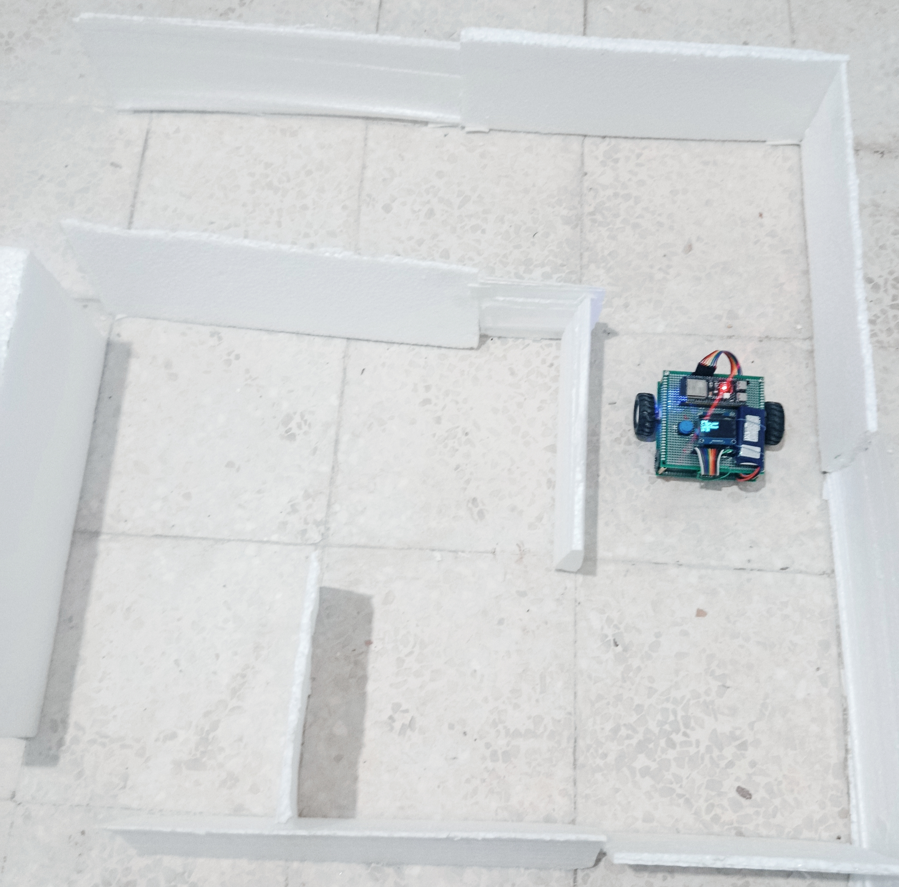
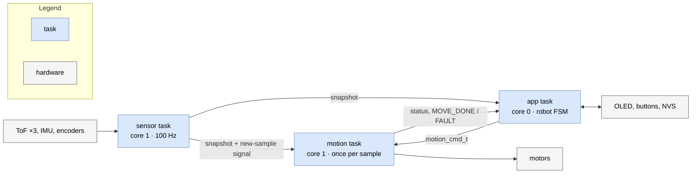

# micro_farr

Competition micromouse on an ESP32-S3: explores the maze to the goal, saves the map, then
speed-runs the shortest known path, all without reflashing.

<p align="center">
  
  
  
</p>
<p align="center"><em>Top view &nbsp;|&nbsp; Underside wiring &nbsp;|&nbsp; Testing in a real maze</em></p>

## Overview



- **sensor**: reads ToF, gyro and encoders, publishes a snapshot, signals the motion task.
- **motion**: runs one move at a time (straight or pivot) through one control cascade.
- **app**: menu, explore, speed run, tuner, fault; owns the OLED and buttons.

Full architecture (hardware, IPC, FSM, control cascade, explore sequence, task table):
[docs/architecture.md](docs/architecture.md).

## Design decisions

- **Per-wheel speed loops.** Each wheel has its own FF+PI on measured speed, so the robot
  drives the same at any battery voltage.
- **One control cascade.** Straights and turns both produce a trapezoid speed reference that
  goes through the same wheel loops; no separate duty-based turn controller.
- **Three tasks, not four.** Only one FSM state is active at a time, so the app task draws its
  own screen; no separate UI task, no shared OLED or buttons.
- **Motion runs once per sensor sample.** It blocks on the sensor task's signal: every control
  step sees fresh data exactly once, and a missing sample stops the move.
- **Gains in RAM.** The tuner changes a RAM table; DUMP prints `#define` lines to paste into
  `main/app_config.h`, which stays the single source of truth.
- **Maze in NVS.** Saved automatically at the goal; survives power cycles and `idf.py flash`.

## Results

To be measured on the robot with the tuner pages (values below are targets to fill in).

| Metric | Page | Result |
| --- | --- | --- |
| Cell distance error (1 and 5 cells) | DISTANCE | TBD |
| Lateral error end / max in a corridor | CENTERING | TBD |
| Peak speed, EXPLORE / FAST | SPEED | TBD |
| Heading error after 90° / 180° pivots | TURNS | TBD |

## Build, flash, tune

ESP32-S3-WROOM-1-N16R8, ESP-IDF 6.1:

```bash
source ~/.espressif/v6.1/esp-idf/export.sh
idf.py set-target esp32s3        # once
idf.py build
idf.py -p /dev/ttyUSB0 flash monitor
tests/host/run.sh                # host unit tests (gcc), no hardware needed
```

Buttons: SEL = next row, INC = enter / increase / start, DEC = decrease / stop,
BOOT = next tuner page.

1. **TUNER**, in this order: DISTANCE → CENTERING → SPEED → TURNS. Each `[RUN]` shows its
   result on the bottom line.
2. **DUMP** prints all values over UART; paste them into `main/app_config.h` and reflash.
3. **EXPLORE**: place the robot at the start cell facing `MAZE_START_DIR`, INC to start. The
   map is saved at the goal.
4. **SPEED RUN**: same start position; drives the saved path with the FAST profile.

Hardware and pin map: [hardware.md](hardware.md).
