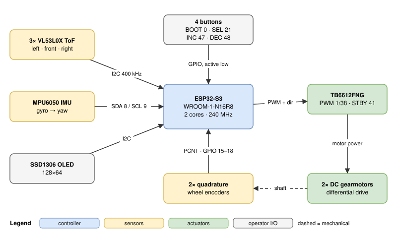
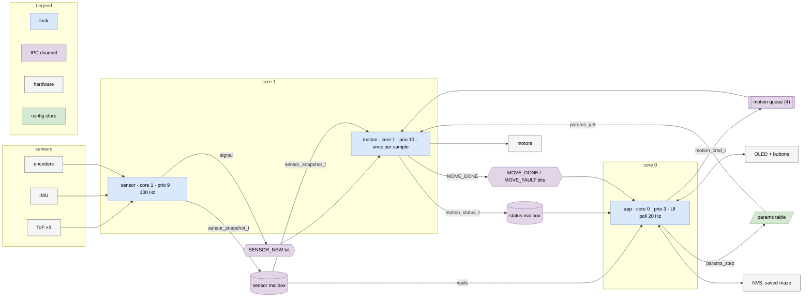
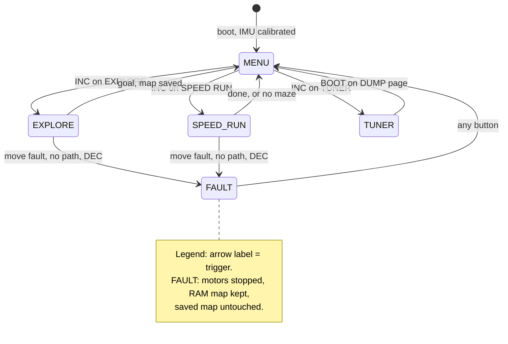
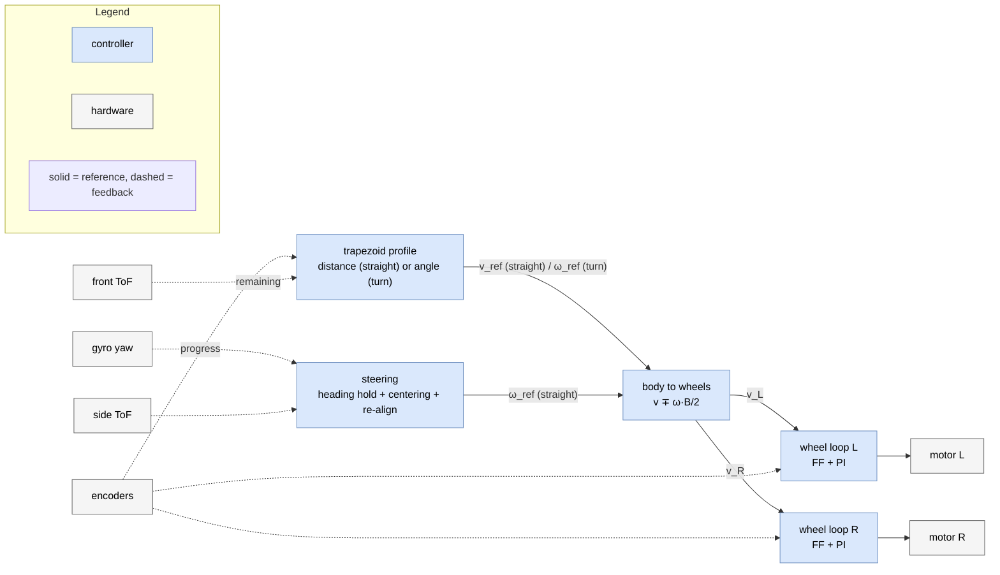
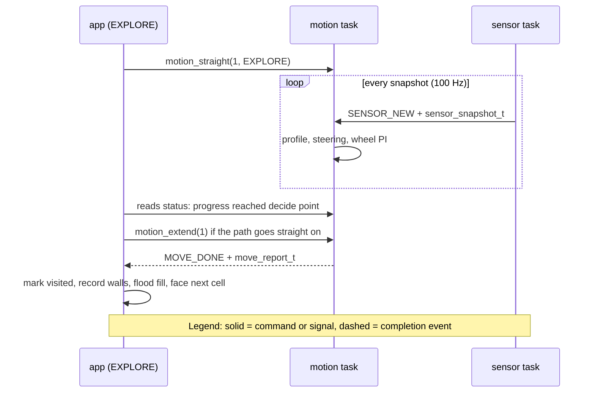

# micro_farr firmware architecture

Three FreeRTOS tasks, one robot FSM, one control cascade for every move.
Design rationale: [firmware restructure design](superpowers/specs/2026-11-21-firmware-restructure-design.md).

## 1. Hardware

Editable: open `docs/diagrams/hardware.drawio.svg` in draw.io. Pin map: [hardware.md](../hardware.md).

## 2. Tasks and IPC

| Task | Core | Prio | Rate | Owns | Reads | Writes |
| --- | --- | --- | --- | --- | --- | --- |
| sensor | 1 | 9 | 100 Hz | ToF, IMU, encoders | hardware | sensor mailbox, SENSOR_NEW |
| motion | 1 | 10 | once per snapshot | motors | queue, snapshot, params | status mailbox, MOVE_DONE / MOVE_FAULT |
| app | 0 | 3 | state-driven, UI poll 20 Hz | OLED, buttons, maze, NVS | status, events, snapshot | queue, params |

`params` is the only shared module outside `app_ipc`: a RAM table of tunable values (aligned
32-bit floats, written by the app, read by motion).

## 3. Robot FSM

Each state is a function `run(ctx)` that returns the next state; the app task loops
`state = s_states[state](&ctx)`.

## 4. Control cascade

- Straight: the profile runs on the remaining ticks (front ToF replaces the encoder value when
  they agree within `FRONT_ALIGN_WIN_MM`), steering adds ω.
- Turn: the profile runs on the remaining angle and gives ω; v = 0.
- Only the wheel loops write motor duty (plus brake at move end).

## 5. One explore step

